# LogForensics

**Local-first security log investigation for Linux authentication and web access logs.**

[](LICENSE)
[](https://www.python.org/)
[](https://nodejs.org/)
[](https://react.dev/)
[](https://fastapi.tiangolo.com/)
[](tests/)

LogForensics turns raw log files into normalized events, explainable detections, a
chronological timeline and a portable investigation record. Every finding points
back to the source file, line number and raw log line that produced it.

It is an investigation aid, **not** a SIEM replacement, and a detection is a lead
for review — not proof of compromise.

## Contents

- [Features](#what-it-does)
- [Screenshots](#screenshots)
- [Stack](#stack)
- [Quick start](#quick-start)
- [Demo account and configuration](#demo-account-and-configuration)
- [Using the workspace](#using-the-workspace)
- [Supported formats](#supported-formats)
- [Detection rules](#detection-rules)
- [Architecture](#architecture)
- [Exports](#exports)
- [Sample analysis](#sample-analysis)
- [Testing](#testing)
- [Security and privacy](#security-and-privacy)
- [Limitations](#limitations)
- [Repository layout](#repository-layout)
- [Documentation](#documentation)
- [License](#license)

---

## Screenshots

All screenshots use the bundled synthetic dataset.

| | |
| --- | --- |
| **Landing** — public product page, no sign-in required | **Sign in** — local session gate before the workspace |
| 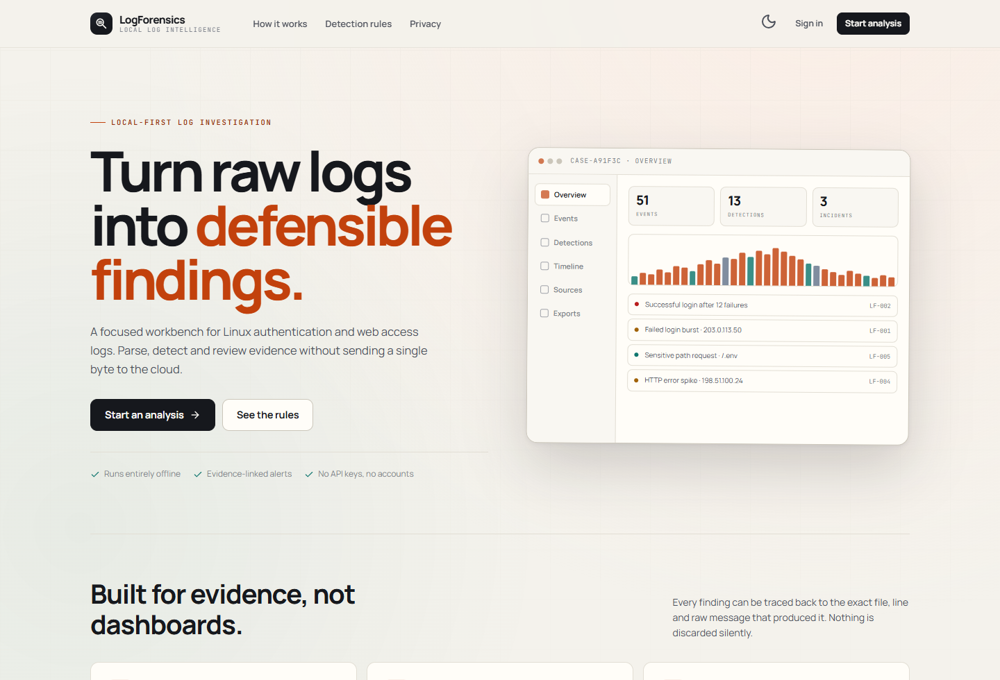 | 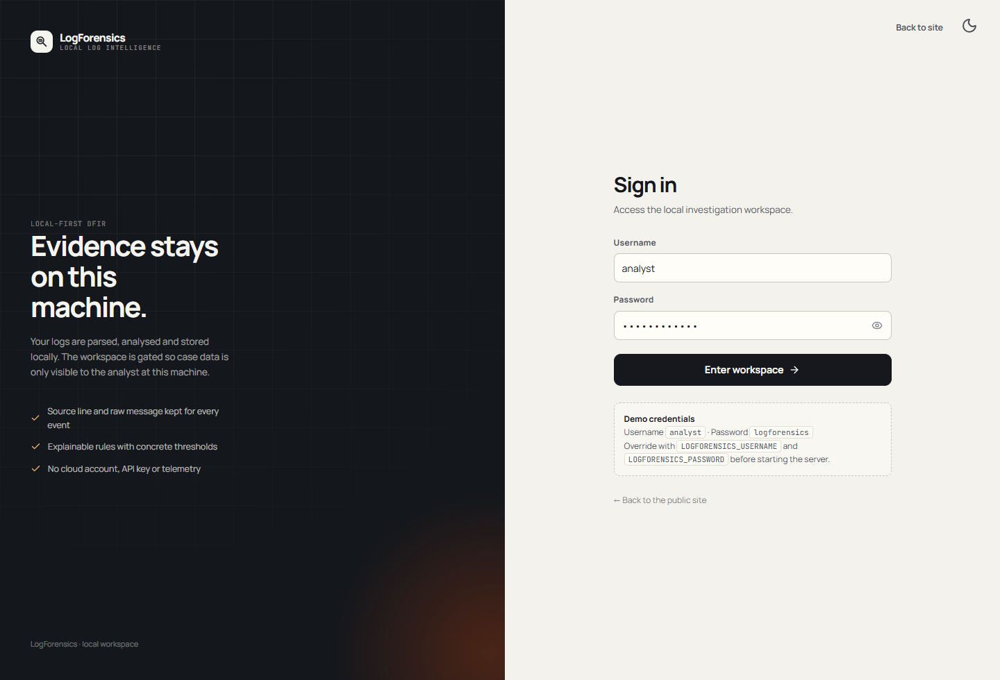 |
| **Overview** — counts, severity mix, incidents and source integrity | **Dark mode** — the same workspace, full contrast |
| 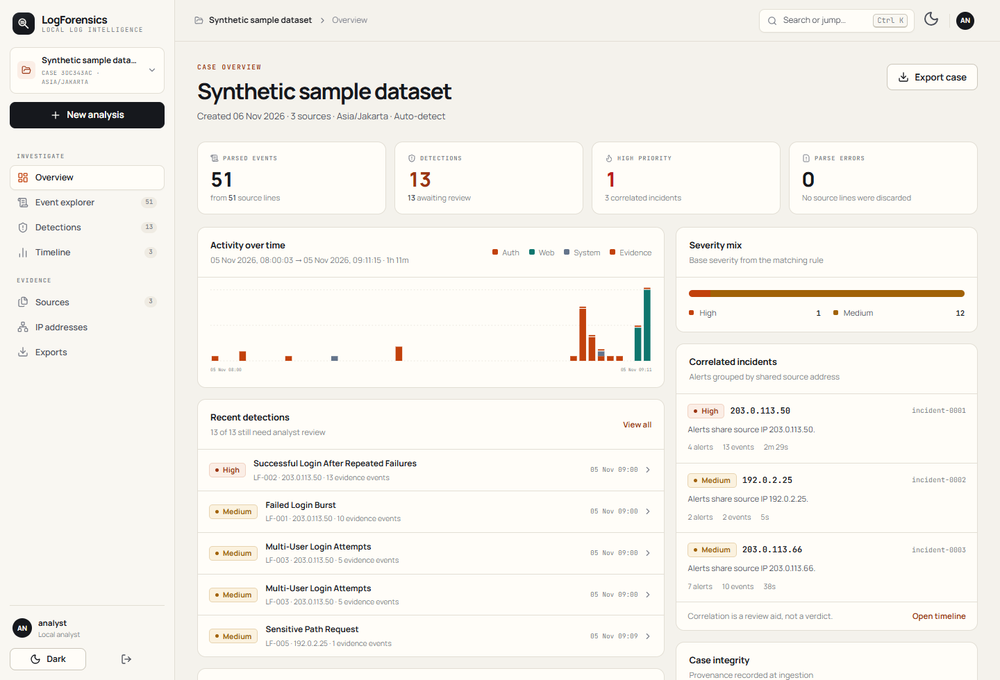 | 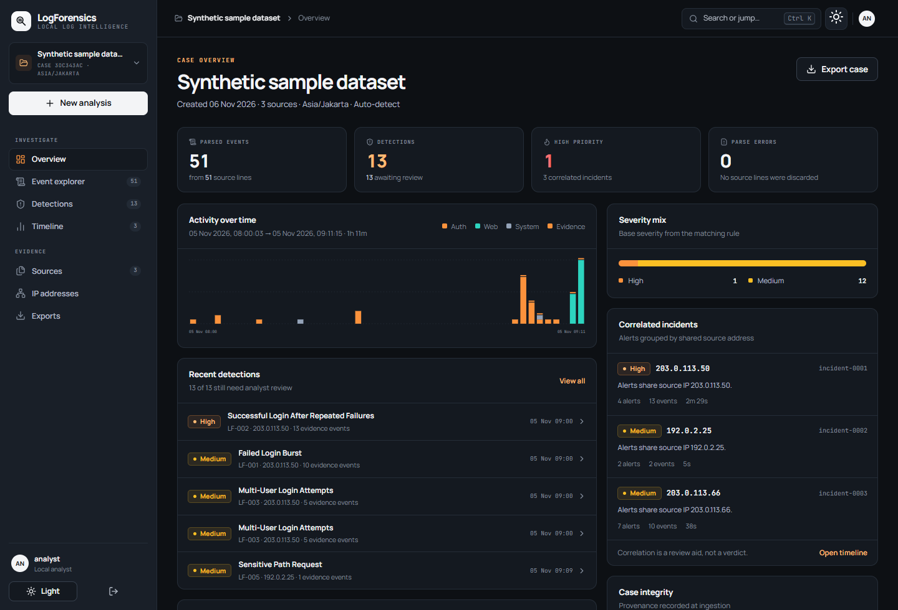 |

| | |
| --- | --- |
| **Event explorer** — server-side search, filters and evidence drawer | **Detections** — rule rationale, evidence and review status |
| 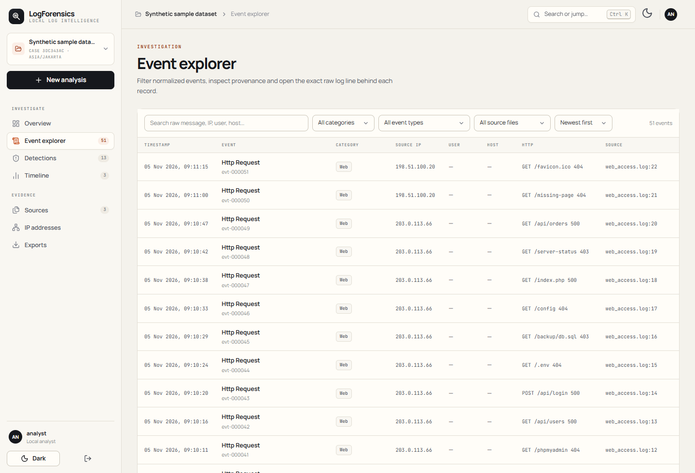 | 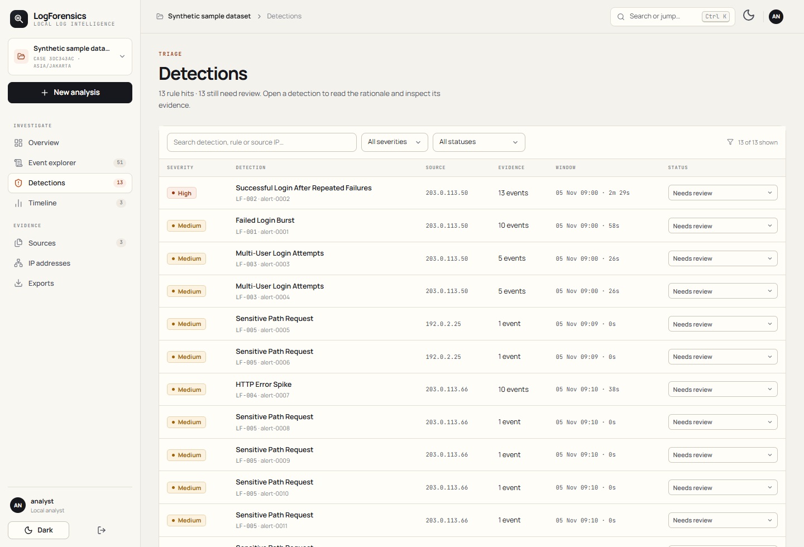 |
| **Event detail** — raw line, parser fields and provenance | **Detection detail** — why it fired, with linked events |
| 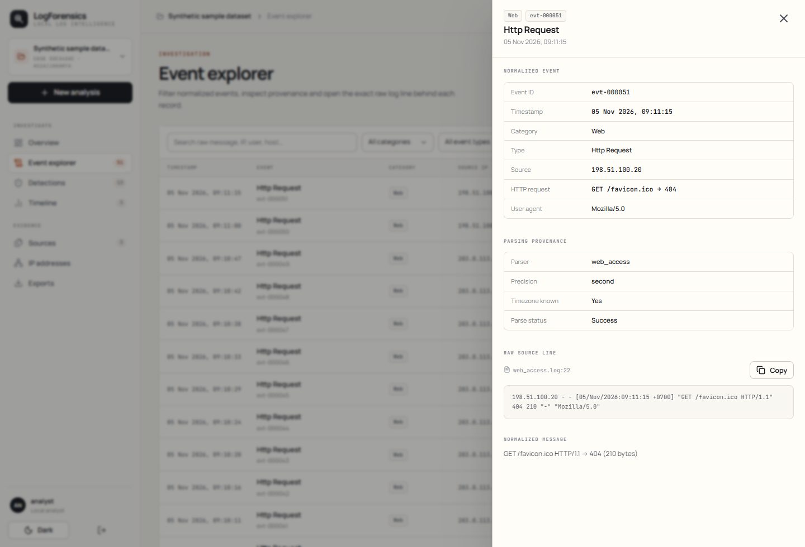 | 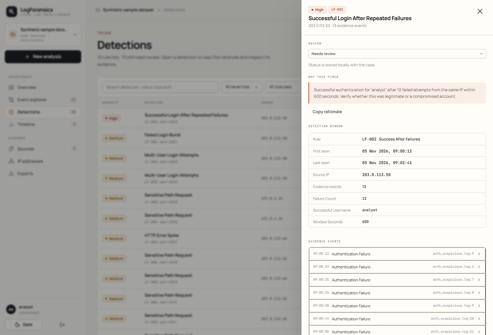 |

| | |
| --- | --- |
| **Timeline** — activity chart and correlated incidents | **Sources & integrity** — hashes, parsers and parse errors |
| 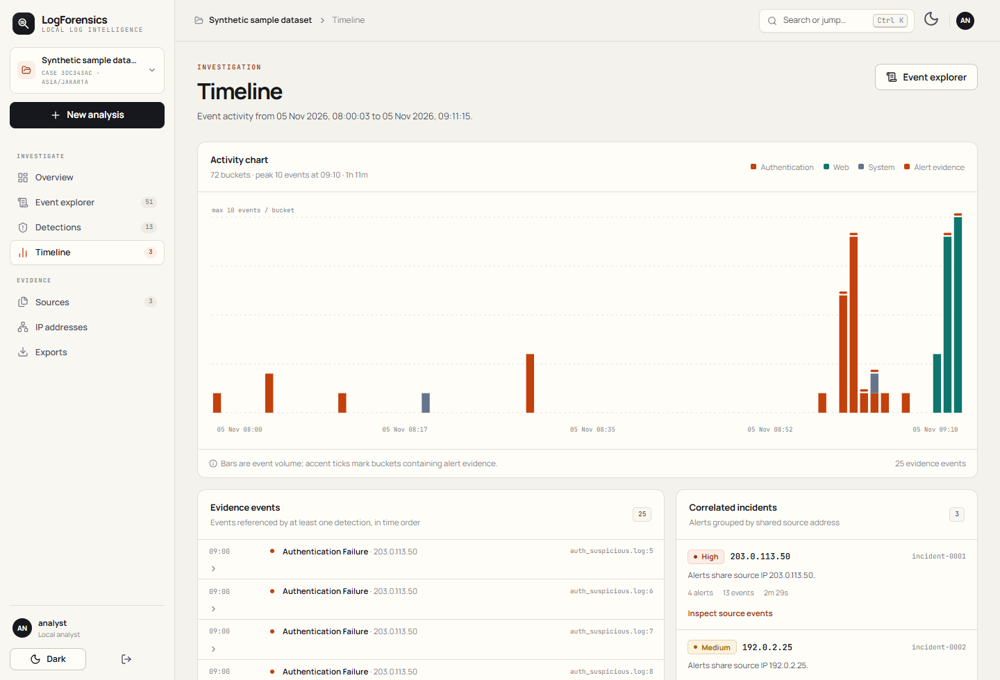 | 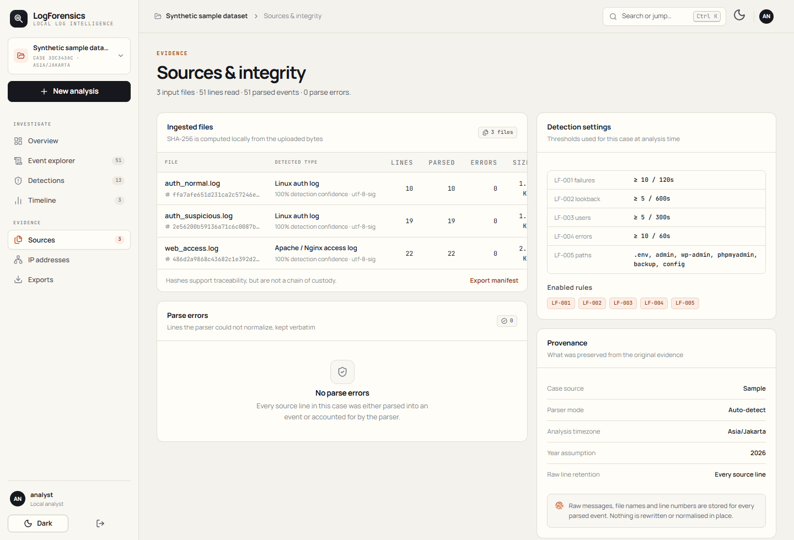 |
| **IP addresses** — activity aggregated per source | **Exports** — individual artifacts or a ZIP bundle |
| 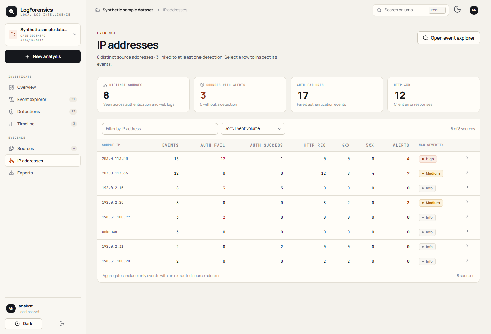 | 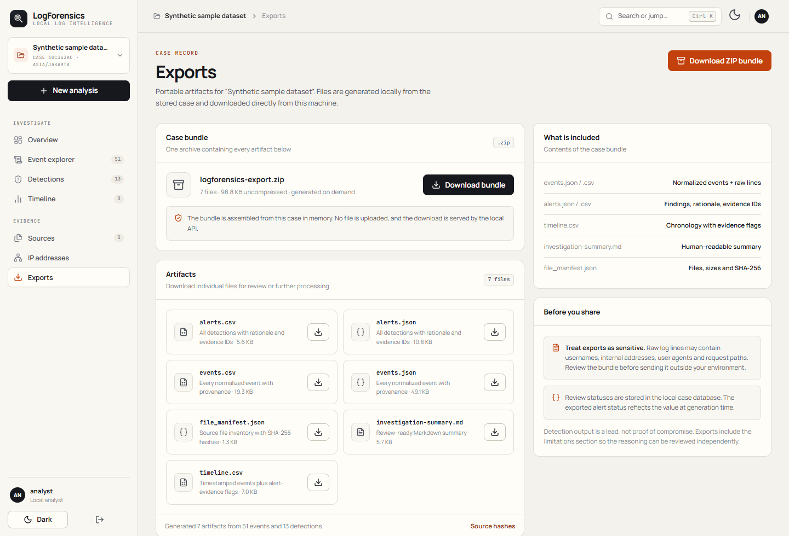 |

Also: [new analysis](screenshots/new-analysis.png) · [404 page](screenshots/not-found.png).

---

## What it does

1. **Ingest** `.log`, `.txt` or `.csv` files, or load the bundled sample. Files are
   validated, decoded and SHA-256 hashed locally.
2. **Detect or choose a parser** for Linux authentication logs and Apache/Nginx
   access logs.
3. **Normalize** every line into one event schema while preserving the raw line,
   file name and 1-based line number.
4. **Detect** with five explainable rules (LF-001 … LF-005), with configurable
   thresholds and rule toggles per analysis.
5. **Correlate** alerts that share a source IP and fall within 30 minutes.
6. **Investigate** with search, facets, an event inspector, a timeline, IP
   aggregation, parse-error visibility and per-alert review statuses.
7. **Export** JSON, CSV, Markdown, a file manifest or a complete ZIP bundle.

Everything runs on the local machine. No API key, cloud service, external database
or telemetry is used.

---

## Stack

| Layer | Choice | Why |
| --- | --- | --- |
| Interface | **React 19 + TypeScript + Vite** | Component UI with explicit state, keyboard access and a real design system — not a script-driven dashboard. |
| API | **FastAPI + Uvicorn** | Typed request models, local-only HTTP API, automatic OpenAPI docs at `/api/docs`. |
| Storage | **SQLite** (WAL mode, indexed) | The app is single-user and local-first. SQLite keeps the case, events, alerts and review status in one portable file with no server to operate. It survives restarts, supports the filters the UI needs, and can be copied or deleted with the case. PostgreSQL would add an operational dependency without a local-first benefit. |
| Typography | **Manrope** + **JetBrains Mono** | Readable UI text; monospaced timestamps, hashes and raw log lines. |
| Icons | **Lucide** | Consistent stroke icons, no emoji or decorative status dots. |

The analysis core (`ingestion`, `parsers`, `normalization`, `detection`,
`correlation`, `analysis`, `reporting`) has no web dependency and can be used from
Python or tested directly.

---

## Quick start

### Requirements

- Python **3.11+**
- Node.js **22+** and npm
- Windows, macOS or Linux

### 1. Install the backend

```powershell
cd LogForensics
python -m venv .venv
.\.venv\Scripts\Activate.ps1
python -m pip install --upgrade pip
pip install -r requirements.txt
```

On macOS/Linux use `source .venv/bin/activate` instead.

### 2. Build the frontend

```powershell
cd web
npm install
npm run build
cd ..
```

### 3. Run the app

```powershell
python app.py
```

Open **http://127.0.0.1:8000**.

The FastAPI process serves both the API and the built React app. The first launch
creates `data/logforensics.db` and opens on the public landing page.

### Development mode

Run the API and Vite separately so the frontend hot-reloads:

```powershell
# Terminal 1 — API on 127.0.0.1:8000
python app.py

# Terminal 2 — Vite on 127.0.0.1:5173
cd web
npm run dev
```

Vite proxies `/api` to the FastAPI process. Use `http://127.0.0.1:5173` during
development.

### Editable install (optional)

```powershell
pip install -e ".[dev]"
logforensics
```

---

## Demo account and configuration

| Setting | Default |
| --- | --- |
| Username | `analyst` |
| Password | `logforensics` |

The sign-in page includes a **Fill demo credentials** action. Override the
defaults before starting the app:

```powershell
$env:LOGFORENSICS_USERNAME = "your-analyst-name"
$env:LOGFORENSICS_PASSWORD = "choose-a-local-password"
$env:LOGFORENSICS_SECRET = "a-long-random-session-secret"
python app.py
```

| Variable | Purpose |
| --- | --- |
| `LOGFORENSICS_USERNAME` | Local sign-in username. |
| `LOGFORENSICS_PASSWORD` | Local sign-in password. |
| `LOGFORENSICS_SECRET` | Signs the session cookie. Set it to keep sessions valid across restarts. |
| `LOGFORENSICS_DB` | Alternate SQLite file path. |
| `LOGFORENSICS_HOST` / `LOGFORENSICS_PORT` | Bind address and port used by `python app.py`. |

This is a **single-user local gate**, not production authentication. There is no
user store, password hashing, rate limiting or per-user authorization. Keep the
server bound to localhost.

---

## Using the workspace

- **Overview** — parsed events, detections, severity mix, activity chart, incident
  summaries and source integrity.
- **Event explorer** — server-side pagination, full-text search, filters for source
  file, category, IP, event type, username and HTTP status, plus an inspector with
  the raw line and every parsed field.
- **Detections** — filter by severity, rule and review status. Open a detection to
  read its rationale, inspect linked evidence events and set the review status:
  `needs_review`, `benign`, `confirmed_suspicious` or `false_positive`.
- **Timeline** — event volume by category, alert-evidence markers and correlated
  incidents. The analysis timezone is always shown.
- **Sources & integrity** — file sizes, encodings, SHA-256 hashes, parser
  confidence, detection thresholds and every parse error with its raw line.
- **IP addresses** — per-source activity totals. Select a row to open the event
  explorer filtered to that address.
- **Exports** — download each artifact or a ZIP bundle.
- **Command palette** — press `Ctrl+K` (`Cmd+K` on macOS) to jump to a page, switch
  case, start a new analysis or toggle the theme.
- **Cases** — create analyses from uploaded files or the sample dataset, switch
  between saved cases and delete a case with confirmation.

Syslog lines lack a year and timezone. Both are explicit settings for each
analysis and are recorded on affected events. Light and dark themes are available
from the top bar and are remembered in the browser.

---

## Supported formats

### Linux authentication log

```text
Nov  5 09:00:12 lab-server sshd[1201]: Failed password for invalid user admin from 192.0.2.15 port 51234 ssh2
Nov  5 09:02:41 lab-server sshd[1203]: Accepted password for analyst from 192.0.2.15 port 51236 ssh2
```

Parsed fields include timestamp, host, process, PID, event type, username, source
IP, source port and the original line.

### Apache/Nginx access log

```text
192.0.2.25 - - [05/Nov/2026:09:10:12 +0700] "GET /login HTTP/1.1" 200 1234 "-" "Mozilla/5.0"
192.0.2.25 - - [05/Nov/2026:09:10:13 +0700] "GET /.env HTTP/1.1" 404 210 "-" "curl/8.0"
```

Both Combined and Common Log Format are accepted. The timezone is treated as
known only when the timestamp carries a numeric UTC offset.

Unmatched lines are never dropped. They appear under **Sources → Parse errors**
and in the JSON export.

---

## Detection rules

| ID | Rule | Default condition | Severity |
| --- | --- | --- | --- |
| LF-001 | Failed Login Burst | 10 failures from one IP within 120 s | Medium |
| LF-002 | Success After Failures | ≥5 failures, then a success from the same IP within 600 s | High |
| LF-003 | Multi-User Login Attempts | 5 distinct usernames from one IP within 300 s | Medium |
| LF-004 | HTTP Error Spike | 10 4xx/5xx responses from one IP within 60 s | Medium |
| LF-005 | Sensitive Path Request | Request to `.env`, `/admin`, `/wp-admin`, `/phpmyadmin`, `/backup` or `/config` | Medium |

Thresholds are lab defaults, not universal baselines. They can be changed per
analysis in the new-analysis form. Every alert stores its rule, reason, event
count, first/last seen, evidence event IDs and metadata.

More detail: [`docs/detection-rules.md`](docs/detection-rules.md).

---

## Architecture

```text
Browser (React 19 + TypeScript)
        │  fetch /api/*
        ▼
FastAPI local API ── signed session cookie
        │
        ├── ingestion   validate · decode · SHA-256 · format detection
        ├── parsers     Linux auth · Apache/Nginx access
        ├── normalization → Event (raw line + file + line number)
        ├── detection   LF-001 … LF-005
        ├── correlation source IP + 30-minute gap
        ├── reporting   JSON · CSV · Markdown · manifest · ZIP
        └── SQLite      cases · files · events · alerts · review status
```

The API serves `web/dist` when it exists, so production use is one local process.
`/api/docs` exposes the OpenAPI schema.

More detail: [`docs/architecture.md`](docs/architecture.md).

### Storage

SQLite runs in WAL mode with indexes on case, timestamp, source IP, severity and
review status. The database stores the normalized events, the original raw lines
and the source file manifest; the original uploaded files are not re-read after
analysis. Case deletion removes the case and its related rows.

The database is local state, not evidence. Use the manifest and exports when you
need to hand off findings.

---

## Exports

| Artifact | Contents |
| --- | --- |
| `events.json` / `events.csv` | Every normalized event with raw message, source file and line |
| `alerts.json` / `alerts.csv` | Detections with rationale, severity and evidence event IDs |
| `timeline.csv` | Chronological events with alert-evidence flags |
| `investigation-summary.md` | Review-ready summary and limitations |
| `file_manifest.json` | File names, sizes, encodings and SHA-256 hashes |
| `logforensics-export.zip` | All of the above in one bundle |

Exports are generated on demand from the stored case and downloaded from the local
API. They contain raw log data — review them before sharing.

---

## Sample analysis

The bundled dataset is synthetic and uses RFC 5737 documentation IP ranges.

- 3 files, 51 parsed events, 0 parse errors.
- 13 detections: LF-001 ×1, LF-002 ×1, LF-003 ×2, LF-004 ×1, LF-005 ×8.
- 3 correlated incidents and 8 distinct source addresses.
- Events span 2026-11-05 08:00–09:11 in `Asia/Jakarta`.
- `auth_normal.log` alone produces no detections.

Exact expectations live in
[`sample_data/expected_results.json`](sample_data/expected_results.json) and are
verified by the test suite.

### Python API

```python
from pathlib import Path

from logforensics.analysis import analyze
from logforensics.ingestion import load_path
from logforensics.reporting import export_all

files = [load_path(path) for path in sorted(Path("sample_data").glob("*.log"))]
result = analyze(files, year=2026, timezone_name="Asia/Jakarta")

print(len(result.events), "events")
for alert in result.alerts:
    print(alert.alert_id, alert.rule_id, alert.source_ip, alert.reason)

artifacts = export_all(result)
artifacts["events.json"]
```

---

## Testing

```powershell
.\.venv\Scripts\python.exe -m pytest
```

Current suite: **54 tests**, covering parsers, normalization, every detection
rule, timeline and correlation, sample expectations, exports, and the FastAPI
endpoints (auth, cases, events, facets, timeline, IPs, alert status, upload,
exports and deletion).

Frontend checks:

```powershell
cd web
npm run build      # TypeScript + production build
npm run lint       # oxlint
node scripts/ui-check.mjs   # desktop + mobile browser assertions
node scripts/screenshots.mjs
```

`ui-check.mjs` and `screenshots.mjs` use `playwright-core` with the system
Microsoft Edge. Start the app first; the scripts target `http://127.0.0.1:8000`
and can be pointed elsewhere with `LOGFORENSICS_URL`.

More detail: [`docs/test-plan.md`](docs/test-plan.md).

---

## Security and privacy

- Files are validated by extension, size, NUL-byte content and text decoding.
- Uploaded content is never executed and is not passed to `eval`/`exec`.
- No log data, hash or case detail leaves the machine. There is no telemetry.
- The session cookie is signed with `LOGFORENSICS_SECRET` (random per process
  unless set) and is `SameSite=Lax`.
- Raw log lines may contain usernames, internal addresses, tokens or personal data.
  The UI escapes log text; treat exports as sensitive.
- CSV exports preserve values verbatim. Spreadsheet applications may interpret
  cells beginning with `=`, `+`, `-` or `@` as formulas — open untrusted exports as
  plain text.
- SHA-256 hashes support change detection but are **not** a chain of custody.

---

## Limitations

- Only Linux authentication and Apache/Nginx access logs are supported.
- Detection is rule-based and intentionally explainable; it produces false
  positives and false negatives.
- Syslog timestamps lack a year and timezone. The chosen assumptions are explicit
  but may still be wrong.
- No Windows Event Log, JSON logs, cloud audit logs, Sigma import, geolocation,
  live monitoring, automatic blocking or disk imaging.
- File size is capped at 10 MiB and 200,000 lines per file.
- The sign-in gate is a local single-user check, not production authentication.
- SQLite is single-writer and intended for one local analyst; it is not a shared
  multi-user case server.

See [`docs/limitations.md`](docs/limitations.md).

---

## Repository layout

```text
LogForensics/
├── app.py                     # local launcher (Uvicorn on 127.0.0.1:8000)
├── src/logforensics/
│   ├── api/                   # FastAPI routes and SQLite case store
│   ├── ingestion/             # file loading and format detection
│   ├── parsers/               # Linux auth and web access parsers
│   ├── normalization/         # common Event schema
│   ├── detection/             # LF-001 … LF-005
│   ├── correlation/           # incident grouping
│   ├── analysis/              # pipeline, timeline, IP aggregation
│   └── reporting/             # JSON/CSV/Markdown/ZIP exports
├── web/                       # React 19 + TypeScript + Vite interface
│   ├── src/                   # pages, components, contexts, design system
│   └── scripts/               # browser UI checks and screenshots
├── tests/
├── sample_data/
├── screenshots/
├── docs/
├── data/                      # local SQLite database (created at runtime)
├── pyproject.toml
└── requirements.txt
```

---

## Documentation

- [`docs/architecture.md`](docs/architecture.md) — layers, API surface and storage decisions.
- [`docs/detection-rules.md`](docs/detection-rules.md) — how LF-001 … LF-005 work.
- [`docs/data-schema.md`](docs/data-schema.md) — the normalized event schema and export columns.
- [`docs/test-plan.md`](docs/test-plan.md) — what the tests and UI checks cover.
- [`docs/limitations.md`](docs/limitations.md) — known scope and quality limits.
- [`LogForensics_Project_Specification.md`](LogForensics_Project_Specification.md) — original product blueprint (historical; the implemented stack is React + FastAPI + SQLite).

---

## License

MIT — see [`LICENSE`](LICENSE).

Acknowledgements: Python, FastAPI, React, Vite, SQLite, Lucide, pytest, and public
guidance from NIST SP 800-61/800-86, the OWASP Logging Cheat Sheet and MITRE
ATT&CK. No third-party log dataset is redistributed.
